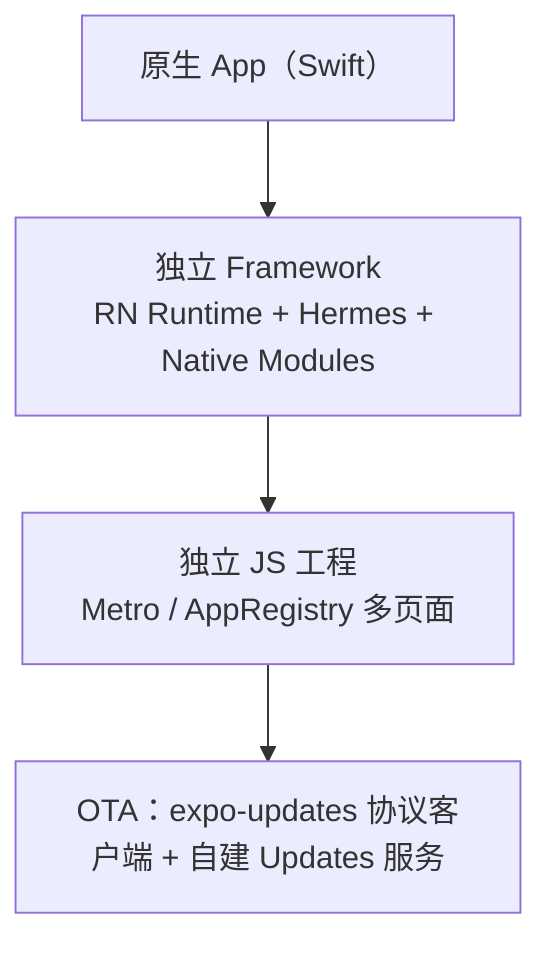
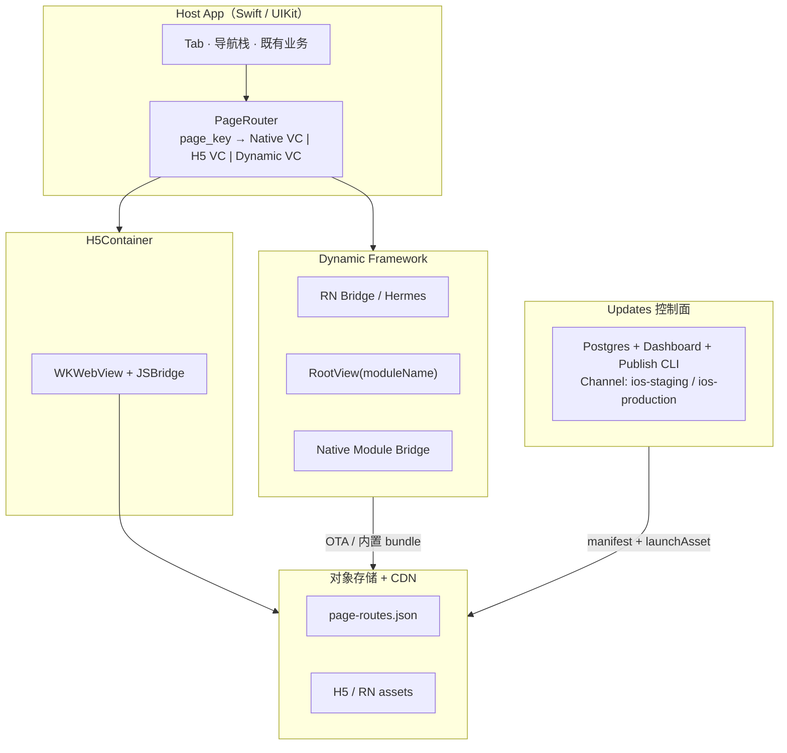
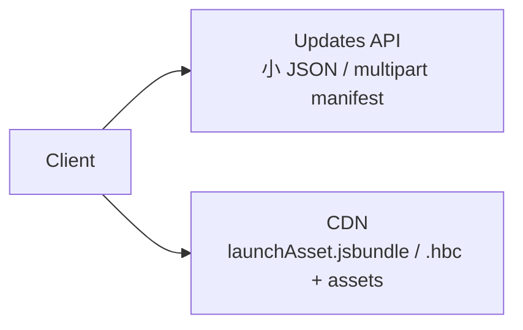
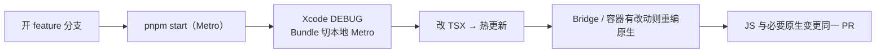
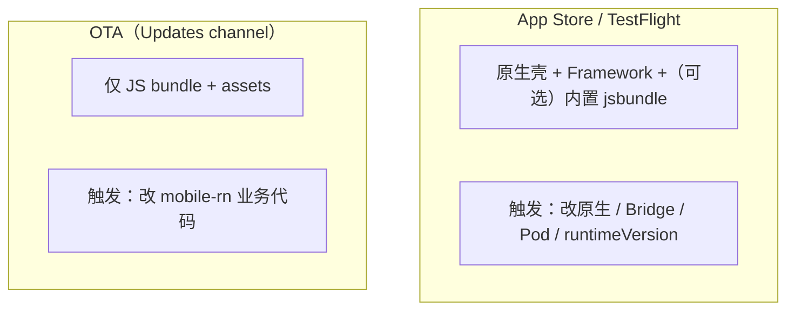
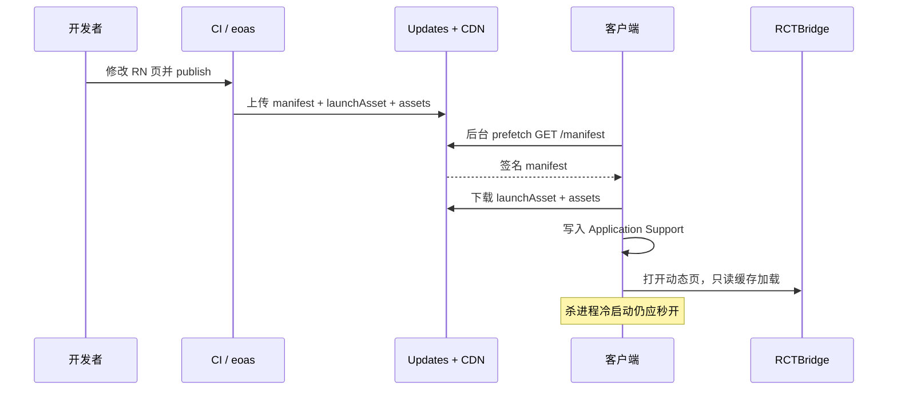

存量 iOS App 已经很大：登录、支付、聊天、推送、原生骨架都在 Swift / UIKit 里。你想让**一部分页面**用 React Native 写，加快迭代、复用 JS 生态，但不想把整 App 重写成 RN，也不想再发一个独立的 App Store 包。动态页还希望能 OTA 换 UI、文案和 JS 逻辑，原生壳继续走商店。

这就是典型的 **Brownfield（棕地）**：原生是宿主，RN 是嵌进去的页面。核心不是「会不会写 TSX」，而是嵌入方式、路由和发布管道有没有一起设计清楚。

---

## 推荐形态



整 App 迁 RN 成本高；独立 RN App 会双包、双登录、跳转体验差；主 Target 直接塞 RN Pods，冲突面大、升级难排查。更稳的是 **独立 Framework Target 挂 RN**。OTA 若要零 SaaS、数据不出境，用 **Expo Updates Protocol + 自建服务** 比托管 EAS Update 更合适。

---

## 总体架构

宿主负责导航栈、既有业务。打开页面走 `PageRouter`：`page_key` 映射到 Native VC、H5 VC 或 Dynamic VC（RN RootView）。

| 层 | 职责 |
|---|---|
| Host App | 导航、系统能力；决定打开哪个 `page_key` |
| Dynamic Framework | 启动 RN Runtime、加载 JS bundle、暴露薄 Native Module |
| JS 工程 | 页面实现、`AppRegistry` 注册、调用 Bridge |
| Updates 服务 | 按 `runtimeVersion` + channel 下发签名 manifest 与 bundle |
| CDN / OSS | 存 bundle、图片等静态资源；可选存路由表 |



H5 走 WKWebView + JSBridge；RN 走独立 Framework 里的 Bridge / Hermes。两边静态资源都可以落到对象存储 + CDN。Updates 控制面（Postgres + Dashboard + Publish CLI）按 channel 发 manifest 和 `launchAsset`。

---

## 在现有 iOS 工程里怎么引入

### 目录先分开

JS 工程和 iOS 工程分目录。CocoaPods 在 iOS 目录执行，但 `NODE_PATH` / `app_path` 指向 JS 工程的 `node_modules`。Brownfield 里最常见的翻车之一，就是 Pod 在 `ios/` 下跑，却找不到旁边那个 RN 工程。

```text
apps/
  ios/HostApp/                 # 既有 Xcode 工程
    Podfile
    HostDynamic/               # 新建 Framework target（RN 只挂这里）
    HostApp/
      Modulars/Dynamic/        # PageRouter、DynamicPageVC、H5 容器
      Resources/Dynamic/       # 内置 main.jsbundle + assets（发版兜底）
  mobile-rn/                   # 独立 RN 工程
    index.js                   # AppRegistry.registerComponent(...)
    app.json                   # runtimeVersion、updates.url、证书
    certs/certificate.pem      # Updates 代码签名公钥（可提交）
```

### 独立 Framework，主 Target 不要直接挂 RN

新建 Framework（如 `HostDynamic`），最低系统版本与 RN 对齐，实践上常见 **iOS 15.1+**。`Podfile` 里 **只在此 target** 引入 RN：

```ruby
platform :ios, '15.1'

rn_root = File.expand_path('../../mobile-rn', __dir__)
ENV['NODE_PATH'] = File.join(rn_root, 'node_modules')

require_relative "#{rn_root}/node_modules/react-native/scripts/react_native_pods"
prepare_react_native_project!

target 'HostDynamic' do
  use_frameworks!
  config = use_native_modules!(['node', "#{rn_root}/scripts/rn-pod-config.js"])
  use_react_native!(
    :path => config[:reactNativePath],
    :app_path => rn_root,
    :config_file_dir => rn_root,
    :fabric_enabled => true,
    :hermes_enabled => true
  )
end

target 'HostApp' do
  use_frameworks!
  # 原有业务 Pods，不要把 RN 塞进来
end

post_install do |installer|
  react_native_post_install(installer, "#{rn_root}/node_modules/react-native")
end
```

主 App 链接 `HostDynamic.framework`，通过公开 API 创建 `RCTRootView`，不要在主 target 直接 `import React`。RN / Hermes / Folly / Expo Modules 的升级和冲突排查被框在 Framework 里，主 App 依赖树更稳定。

### JS 入口与宿主容器

```js
import { AppRegistry } from 'react-native';
import FeaturePageA from './src/pages/FeaturePageA';

AppRegistry.registerComponent('FeaturePageA', () => FeaturePageA);
```

原生打开动态页时传入 `moduleName`（与 `AppRegistry` 名称一致）和 `initialProperties`（如 `pageKey`）。

```swift
final class DynamicPageViewController: UIViewController {
  func load(moduleName: String, props: [String: Any]) {
    HostDynamicRuntime.prepareIfNeeded()
    guard let root = HostDynamicRuntime.makeRootView(
      moduleName: moduleName,
      initialProperties: props
    ) else { return }
    view.addSubview(root)
  }
}
```

Bundle 来源做成可切换：内置 Bundle（Release 默认、离线兜底）、本地 Metro、远程 OTA、自定义 URL。**API 环境与 Bundle 环境应解耦**：完全可以业务 API 打一套环境，RN 却连着本机 Metro。

### Native Module：薄转发，语义对齐 H5

JS 不能直接碰 Keychain、关页面、跳原生路由。统一做薄 Bridge，与 H5 JSBridge **语义对齐**（同一套命令名，两端实现），例如：

| 方法 | 说明 |
|---|---|
| `getAuthToken` | 返回宿主已登录态 token |
| `getApiBaseUrl` | 当前业务 API 基址 |
| `close` | 关闭当前动态页 VC |
| `navigateNative` | `{ pageKey }` → 宿主路由 |
| `trackEvent` | 埋点透传 |

业务依赖留在主 App（网络封装、登录态）；Framework 里 Native Module 薄转发到主 App 注入的 delegate。改 Bridge 接口等于改原生契约，必须升 `runtimeVersion` 并走商店发版。

### PageRouter：用 `page_key`，不要硬编码「这个按钮打开 RN」

```json
{
  "version": 1,
  "routes": {
    "feature.a": {
      "type": "dynamic",
      "moduleName": "FeaturePageA",
      "minAppVersion": "1.0.0"
    },
    "feature.b": {
      "type": "h5",
      "url": "https://cdn.example.com/h5/feature-b/index.html",
      "minAppVersion": "1.0.0"
    },
    "settings.about": {
      "type": "native",
      "className": "AboutViewController"
    }
  }
}
```

解析顺序建议：内存缓存（短 TTL）→ 业务 API（可按用户 / 实验组覆盖）→ CDN JSON（全局默认）→ App 内 `defaults.json`（全链路失败兜底）。这样可以不发版就把某页从 H5 切到 RN，或回滚到原生。

### 工程约束

RN 用 0.76+（New Architecture + Hermes），minor 锁定。最低 iOS 与 RN 对齐。JS 工程内 pnpm/yarn，**不要** hoist 到 monorepo 根，否则 Metro 解析会炸。Brownfield 下慎用强依赖 Fabric / 复杂手势库的版本；能用 RN `Animated` 就少引 Reanimated。装新 RN 原生依赖后：`pod install`，然后 **Xcode 完整重编**，不要只增量编译碰运气。

---

## 需要自建哪些服务

「引入 RN」不只是客户端。要稳定跑 OTA，至少准备 Updates 控制面和对象存储。

**Updates 控制面**：实现 Expo Updates Protocol。开源选型之一是 **xprem**（MIT）：Updates API（`GET /manifest`，按 platform、runtimeVersion、channel）、Postgres、Dashboard、Publish CLI（如 `eoas`）。客户端用 `expo-updates`（bare workflow），`updates.url` 指向你的域名。部署可以是 sidecar（与业务 API 同 compose），流量大了再拆独立集群。前面挂 HTTPS 反向代理。

**对象存储 + CDN**：控制面只负责 manifest；bundle 与图片放 OSS/S3，CDN 加速。注意 `CDN_BASE_URL` 与 bucket key 前缀不要叠成 `/ota/ota/`。



路由配置可选：仅 CDN JSON 做全局默认和灾备；业务 API 做按用户 / 实验覆盖；App 内 defaults 做离线兜底。若动态页同时支持 H5，同一套 Bridge 语义，静态站放 CDN 即可，不必再起 Node 渲染服务。

不需要自建的：EAS Build / EAS Update 可完全不用；RN 页直接打业务 API，鉴权走 Bridge 拿 token；Metro 只在开发机需要，线上不跑。

---

## 开发流程

日常改一个 RN 页面：feature 分支 → `cd apps/mobile-rn && pnpm install && pnpm start` → Xcode DEBUG，Bundle 切到本地 Metro → 改 TSX 热更新。Bridge / 原生容器有改动，再编一次原生。JS 与必要的原生 / Podfile 变更放同一 PR。



Metro 默认 8081，若本机业务 API 也占用，改其一（如 `pnpm start --port 8082`）。Node 路径写到 `.xcode.env.local`（gitignore），模板用 `.xcode.env`。

首次把机器跑起来：

```bash
cd apps/mobile-rn
pnpm install

cd apps/ios/HostApp
pod install
open HostApp.xcworkspace

# 可选：打一份内置 bundle 进 App 资源目录
pnpm build:ios
```

联调 OTA 时用 **cache-first**：打开 RN 页只读本地缓存；下载发生在冷启动后台预取。有缓存应秒开；无缓存显示「准备中」并等待同一次 prefetch。失败时明确错误 + 重试，**不要静默回落内置包**，否则会误以为 OTA 成功。Brownfield 下若 `expo-updates` 的 `AppController` 启动路径不稳定，DEBUG 可用「Disabled 控制器 + 直连下载 manifest/assets」；Release 仍可先吃内置 bundle，产品化远程 OTA 再打开。

---

## 打包与部署：两条管道



内置 bundle 跟商店包走，给首次安装、无网、OTA 未拉到时兜底，也让 Review 包行为可预期：

```bash
cd apps/mobile-rn
react-native bundle \
  --platform ios \
  --dev false \
  --entry-file index.js \
  --bundle-output ../ios/HostApp/.../Resources/Dynamic/main.jsbundle \
  --assets-dest ../ios/HostApp/.../Resources/Dynamic
```

OTA 一次性准备：部署 Updates + Postgres；Dashboard 创建 App；公钥 `certificate.pem` 进 JS 工程（**私钥勿提交**）；channel → branch 映射；CI Secret 放 Publish Token。日常：

```bash
export EOO_TOKEN=eoo_xxx
npx eoas@3.1.3 publish --branch ios-production --platform ios --nonInteractive
```

`runtimeVersion` 是 **原生契约版本**，不是业务版本号。只改 JS 页面不升；增删改 Native Module、升级 RN / Hermes / 带原生代码的库、Framework 公开 API 不兼容，都要升并商店发版。旧壳拉到要求更高 runtime 的 update 时，服务端应不匹配该 update；客户端继续用旧缓存或内置包。

回滚：

```bash
npx eoas rollback --branch ios-production
# 或重新 publish 上一份已知良好的产物到同 branch
```

保留 last-good 本地缓存，避免回滚窗口内白屏。

安全边界：允许 OTA 的是动态页 UI、文案、纯 JS、路由配置、静态资源。禁止 OTA 新增原生 SDK、改 Bridge 接口，以及绕过商店审核的可执行原生代码。配套 manifest 代码签名、HTTPS only、H5 域名白名单。Release 是否默认拉远程 OTA 是产品决策，可先内置，再打开远程。

端到端时序：



服务端探测（无需 token）：

```bash
curl -sS -D - -o /tmp/manifest \
  -H 'expo-protocol-version: 1' \
  -H 'expo-platform: ios' \
  -H 'expo-runtime-version: 1' \
  -H 'expo-channel-name: ios-production' \
  -H 'expo-app-id: <your-app-id>' \
  'https://updates.example.com/manifest'
```

Dashboard 的 Devices 计数通常只统计真实客户端拉取，curl 不计。

---

## 常见坑

1. **主 Target 直接挂 RN Pods**。升级一次冲突排查半天。优先 Framework 隔离。
2. **`pod install` 找不到 `react-native`**。Pod 在 ios 目录跑，依赖却在 JS 工程；必须设 `NODE_PATH` / `app_path` / Expo autolinking `--project-root`。
3. **pnpm 默认隔离布局**。Metro 需要 hoisted 的 `node_modules`（工程内 `.npmrc`：`node-linker=hoisted`），不要在 monorepo 根 hoist。
4. **Metro 与业务 API 抢 8081**。开发期改端口，环境开关写清楚。
5. **OTA 下了 JS、图片 404**。Hermes 字节码里不一定有明文 asset 路径；需要按 hash 落盘 `_bykey`，并在 JS 侧做 asset resolver，或维护 Metro 近 bundle 镜像。
6. **以为打开页面就会自动 OTA**。cache-first 下应先 prefetch，否则每次进页转圈。
7. **Bridge 改了却只发 OTA**。旧客户端没有新方法会炸。必须升 runtimeVersion 发商店。
8. **原生依赖选太新**。部分 maps / gesture 库强绑 Fabric 或不兼容当前 RN codegen，Brownfield 上更脆。锁定已验证版本。

---

## 小结

在现有 iOS App 里引入 RN，真正要设计清楚的是三道边界：

1. **嵌入边界**：独立 Framework 挂 RN，宿主只通过容器 VC + Bridge 交互
2. **配置边界**：`page_key` 路由决定 Native / H5 / RN，可远程调整
3. **发布边界**：原生契约走商店 + `runtimeVersion`；纯 JS 走自建 Updates OTA

服务侧最少要有 **Updates 控制面 + 对象存储 / CDN**。业务 API 与 Metro 都不是线上 OTA 的前置依赖。开发期把 **Metro / 内置包 / 远程 OTA** 三种加载路径打通，后续扩页面才会稳。
